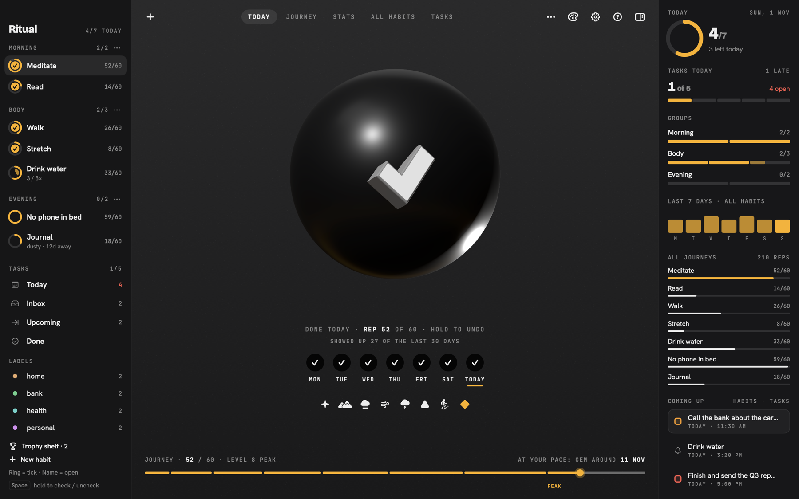
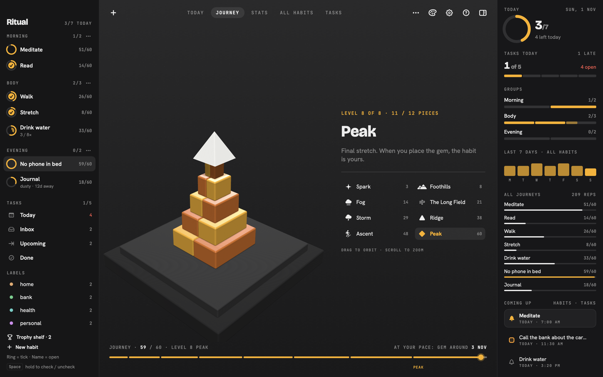
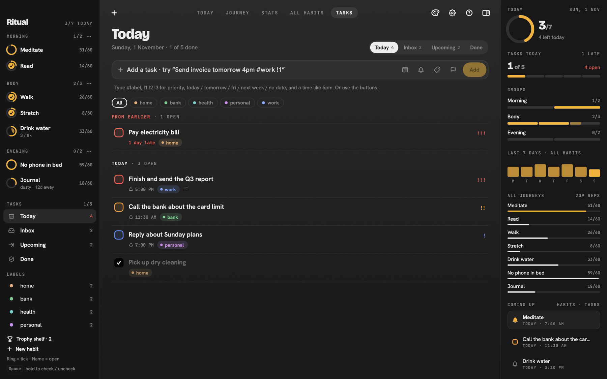
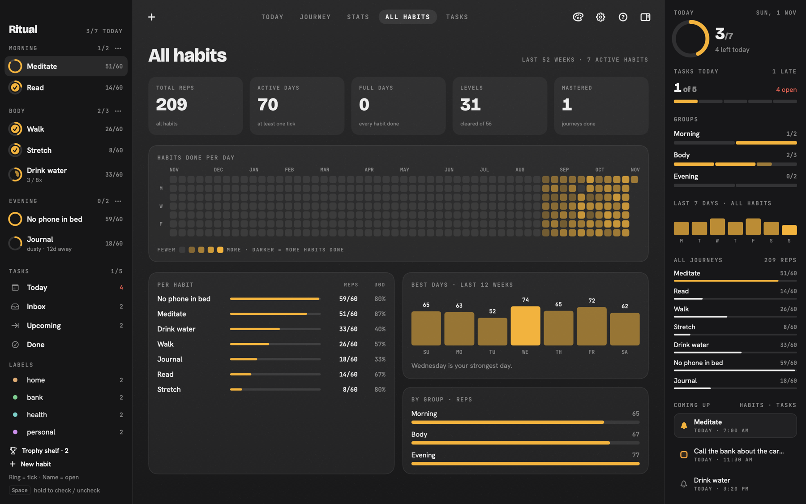
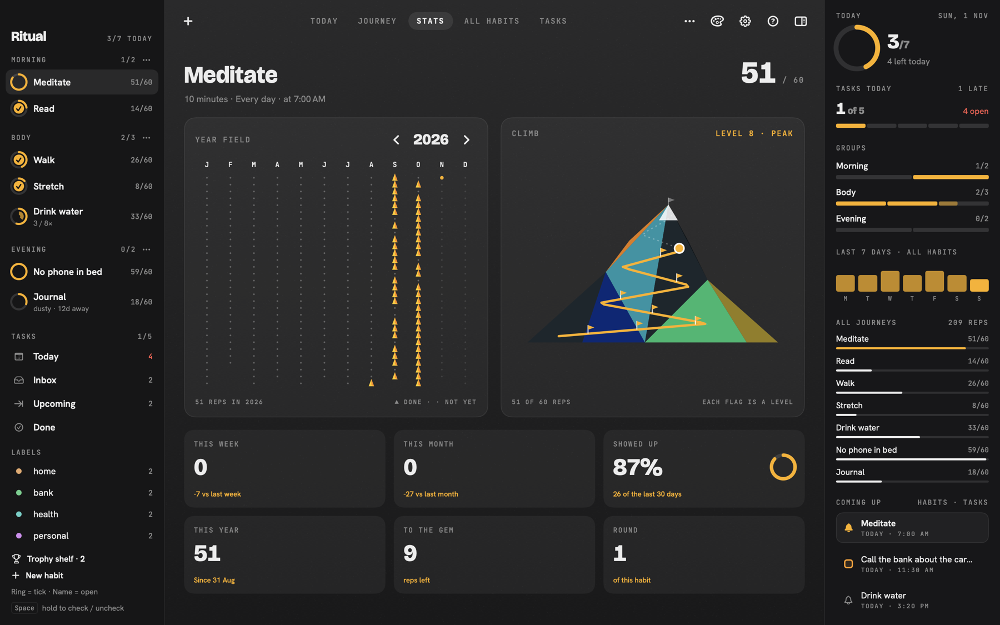
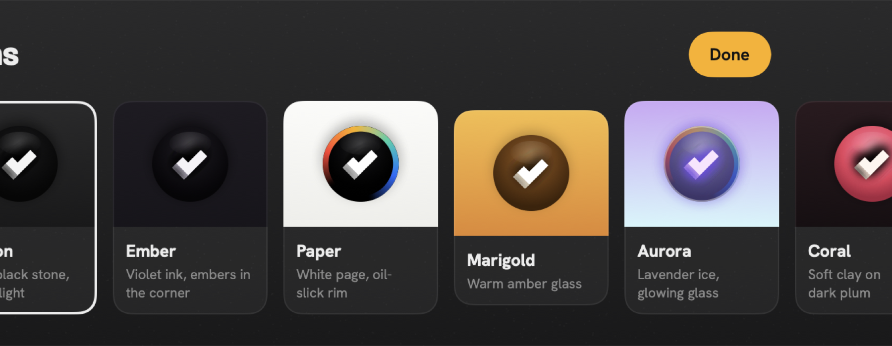
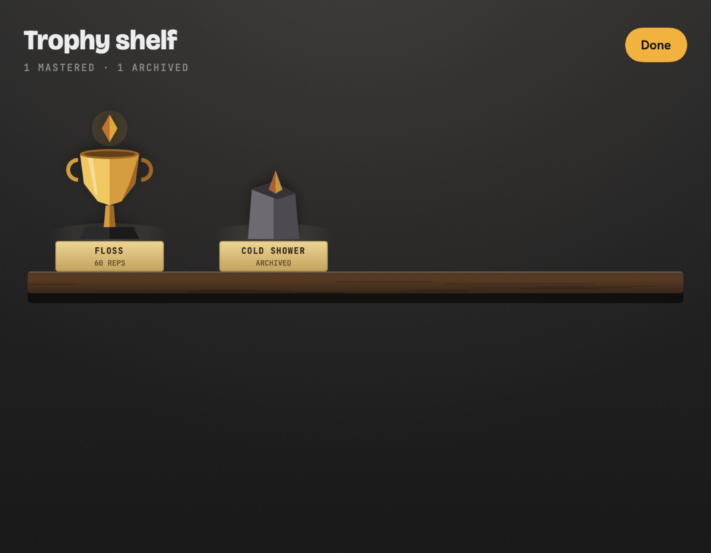

# Ritual

**Make your days add up.**

Ritual is a home on your Mac for everything you mean to do. Habits you're building and tasks you need to get done live in one window, with one set of gentle reminders. It's made to be a pleasure to open.

*Got a habit app, a to-do app and a pile of sticky notes? Ritual puts them in one place.*



---

## What makes it different

**Your habits build something you can see.**
Hold the orb to check in, and a piece drops into place on that level's monument. Sixty check-ins take you through eight levels, each with its own shape, and the last one places a gem on top. Days you miss don't take anything away. The count only goes up.



**Your to-dos don't slip.**
Type `Call the bank tomorrow 11:30am #bank !2` and Ritual picks up the day, the time, the label and the priority as you type. Unfinished tasks move up to today and show how late they are. Finished ones stay crossed out until midnight, so you can see what you got done.



**Your whole day in one view.**
The day pane shows every habit, today's tasks, your groups, the last week, and what's coming up next across habits and tasks. The menu bar shows the same at a glance, and you can tick things off from there.



**It notices, kindly.**
Instead of a streak counter, you see "Showed up 22 of the last 30 days". Stay away for a week and a little dust settles on the orb; one check-in clears it. The journey bar shows where your current pace will take you, and when you'd place the gem.



**It looks like nothing else on your Mac.**
Six hand-made skins (Carbon, Ember, Paper, Marigold, Aurora, Coral) change the background, the orb's material, the monuments and the accent colour. Every check-in comes with layered sound, motion and light.



**It's yours.**
No account, no network, no ads, no AI. Everything lives in one JSON file on your Mac, with a backup taken every day.

## The details

- **Habit goals:** once a day, a count ("8 glasses"), or an amount ("10 pages"). Journeys can be 30, 60 or 90 reps.
- **Groups** for your morning, evening or anything else, each with its own progress in the sidebar.
- **Trophy shelf** for finished journeys and retired habits. Bring any of them back later.

  

- **Reminders** at as many times as you like, per weekday, with Done and Snooze on the banner. Also: quiet hours, and an optional evening "anything left?" check-in.
- **Tasks:** Today, Inbox for tasks with no day, Upcoming and Done. Labels in your own colours, optional priority, a reminder per task, and drag and drop onto the sidebar.
- **Keyboard-first:** hold Space to check in, ⌘5 for Tasks, ⌥⌘N for a new task, ⌘Z to undo.
- **Export** to JSON or CSV at any time, and import a JSON export back.

## Cooking 🍳

- **Widgets.** Eleven desktop widgets are designed and built: Orb, Week, Month, Grid, Climb and more. macOS only shows widgets from apps signed with an Apple developer certificate, so they don't appear in the downloadable build yet.

## Install

Ritual runs on **Apple Silicon Macs with macOS 15 or later**.

1. Download `Ritual-<version>.dmg` from [Releases](../../releases), open it, and drag Ritual into Applications.
2. Open Ritual. macOS will say it can't check the app for malicious software, because Ritual isn't signed with a paid Apple developer certificate. Click **Done**.
3. Go to **System Settings → Privacy & Security**, scroll down to the message about Ritual, and click **Open Anyway**. You only need to do this once.

Or build it yourself (below). You'll need Apple's free Command Line Tools, but not Xcode.

## Build from source

```sh
xcode-select --install   # once, if you don't have the Command Line Tools
./build.sh               # build, install to ~/Applications/Ritual.app and launch
./build.sh --demo        # launch with sample data (kept in demo.json, separate from yours)
./test.sh                # logic checks
./tools/make-dmg.sh      # build build/Ritual-<version>.dmg
```

`build.sh` picks the first macOS SDK that works with your Swift compiler. Set `RITUAL_SDK` to pick one yourself.

## Keyboard

| Keys | Action |
|---|---|
| Hold Space | Check in (hold again to undo) |
| ⌘↩ | Tick or untick the selected habit |
| ⌘↑ / ⌘↓ | Previous / next habit |
| ⌘1–⌘5 | Today, Journey, Stats, All habits, Tasks |
| ⌘N / ⌥⌘N | New habit / new task |
| ⌘E | Edit the habit or task |
| ⌘, / ⇧⌘, | Settings / skins |
| ⌥⌘0 | Show or hide the day pane |
| ⌘Z | Undo while the toast shows |

## Your data

- **Location:** everything is in `~/Library/Application Support/Ritual/data.json`. It's plain JSON and safe to back up.
- **Backups:** a copy is saved once a day in `Backups/` next to it, and the last 14 are kept.
- **Reminder log:** `reminders.log` lists what's queued after each change, which helps if a reminder misbehaves.

## For developers

- **Code layout:**
  - `Shared/`: model, skins and drawing, used by the app and the widgets.
  - `App/`: the SwiftUI app.
  - `Widgets/`: the WidgetKit extension.
  - `tools/`: the icon generator and the DMG script.
  - `design/`: HTML design boards.
- **Snapshots:** `open --env RITUAL_SNAPSHOT=/tmp/snaps ~/Applications/Ritual.app --args --demo` writes a PNG of every tab, sheet and settings page, then quits.

See [CONTRIBUTING.md](CONTRIBUTING.md) to help out.

## License

MIT. See [LICENSE](LICENSE). The bundled fonts (Bricolage Grotesque, Hanken Grotesk, JetBrains Mono) are under the SIL Open Font License; see `Resources/Fonts/OFL-*.txt`.
